# Weblets

An approach to making software that allows non-programmers to create custom applications for their own needs.

## Embeddable Cooperating Webapps

Weblets are web applications that can join forces at runtime. You can combine simple weblets into a more complex application. Without programming.

The most basic weblet is a layout weblet. A layout weblet can embed one or more other weblets. One layout weblet could be a list layout. Each weblet added, is rendered below the last one, e.g:

```plantuml
@startuml
    skinparam backgroundColor #FFFFFF
    salt
    {+
        List layout weblet
        {+
           Item One       <&minus>
        }
        {+
           Item Two       <&minus>
        }
        [<&plus> add Item]
    }
@enduml
```

Each weblet is a standalone web application, with a URL. A weblets URL will show just that weblet.

Weblets can cooperate even if they have different URL domains. Normal web security measures prevent communication over HTTP(S), but if embedded as an iframe, communication using the [postMessage API](https://developer.mozilla.org/docs/Web/API/Window/postMessage) is possible. For this to work, all weblets must implement a common bus protocol using this (postMessage) API.

There are a number of security considerations, which I'll address later.

Most weblets will combine information with a viewer/editor for that information. E.g. a datagrid weblet will incorporate a feature to edit the value in a specific cell.

*Think of a weblet as a document, like a Microsoft Word document, but it is also the Word application itself. So you can open the weblet and view or even edit the information contained within it.*

All weblets will provide one or more API's, using the common bus, to allow other weblets to retrieve or alter information.

## Implementation

A weblet that can embed other weblets, should listen for [drop events](https://developer.mozilla.org/en-US/docs/Web/API/HTML_Drag_and_Drop_API) with a URL payload. If such an event occurs, they should try to embed that URL as a weblet. There should be a common javascript library for this.

Weblets may also allow a user to create a new weblet and embed that. In that case a weblet must be able to show a list of suitable weblets. This list should be personalizable.

Weblets know where their data is, but may require a user to login to get access. But data may also be provided by a parent weblet, using the common bus. In that case, the weblet must send updates back to the parent weblet, and not save/fetch data itself. Finally a mix of these two is possible.

To create a common look and feel, things like file selection, login forms, etc. should use a common javascript library. This can be implemented as a specific API on the common bus. That way, the design can be set by a 'root' weblet and all embedded weblets will automatically follow this design.

The idea is that instead of opening a file select dialog directly, a weblet will ask the parent weblet to show such a dialog. Now the parent weblet can decide which weblet or library to use.

Weblets should have a fallback option, in the case that either there is no parent weblet, or that the parent weblet has no preference.

## Proposed Weblets

To make the weblets idea more concrete, here is a list of some of the weblets I would like to have. Each should do one thing only and do it well.

### Layout weblets

- list
- columns
- desktop
- tabs

### Visualization

- graphs

### Planning

- todo

### Communication

- comment
- chat

### Information

- contacts
- datagrid
- file select (solid)

## Libraries needed

### Dragdrop handler

A library that allows you to create dropzones that listen for URL drops. And then give control to the weblet code to handle that. The library must provide some default handlers to make it easy to implement.

### postMessage bus

This is the base library that all weblets must include. It allows the weblet to send and receive messages to/from the common bus. It also initializes the bus, and it provides an API to connect to other weblets.

The common bus does not specify any message format, other than that each message must specify an API URI. Each weblet may implement handlers for multiple different API URIs. Each API URI defines the format of messages and the set of valid messages. 

By using URI's as the identity for an API, weblets avoid problems with conflicting namespaces. The URI scheme allows you to be certain no-one else can use your API id for something else. In addition, you can use the URI as a URL to show a description of the API.

## Common Bus Base API's

### connect

`https://purl.org/pdsinterop/weblet-connect`

Sets up the connection between a parent and child, or between two iframes or web workers or windows.

### embed

`https://purl.org/pdsinterop/weblet-embed`

This allows the child to communicate with a layout weblet about its size requirements and the parent weblets affordance. It should allow weblets to communicate minimum and maximum sizes.

### seamless

`https://purl.org/pdsinterop/weblet-embed-seamless`

This allows for seamless iframes. Seamless means that the iframe automatically grows to encompass its contents. It should also allow for some common styling to be shared, e.g. font formats, colors, etc.

### request weblet

`https://purl.org/pdsinterop/weblet-request-weblet`

This allows a weblet to request from its parent weblet access to a specific weblet, or a weblet that implements a specific API. The parent can either link an existing weblet, or instantiate a new weblet. This may require the user to make a choice, so each request should also contain a human readable description describing the use case.

## add/create new weblet

`https://purl.org/pdsinterop/weblet-select-weblet`

This allows a weblet to show a list of suitable weblets, from which a user selects one (or more) to embed in this weblet. The list may be filtered by specifying one or more required API's.

This API assumes that there exists a weblet store, similar to an app store, either personal or shared. This must contain at least an uptodate list of API's supported per weblet, as well as a base URL per weblet. Additionally: title, description, screenshot, tags, etc.

## open questions

It is unclear what the performance impact of iframes is. Can we get away with an iframe per comment for example? Or should a comment weblet allow for multiple comments, to lower the impact of each comment.

Should core common bus data formats use linked data, or just javascript objects or JSON? By requiring linked data formats, the core javascript size grows quite a bit. But using linked data from the start avoids schema migration problems.

